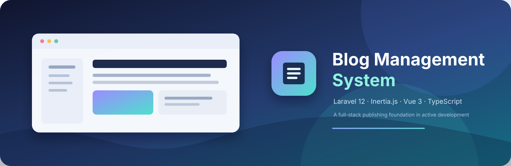
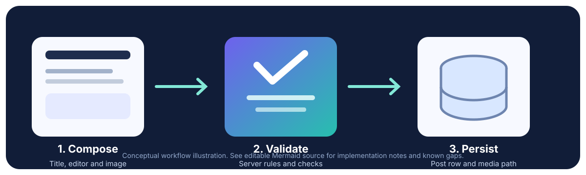
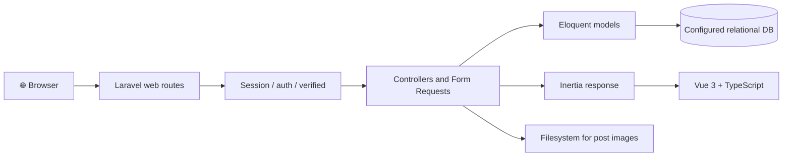
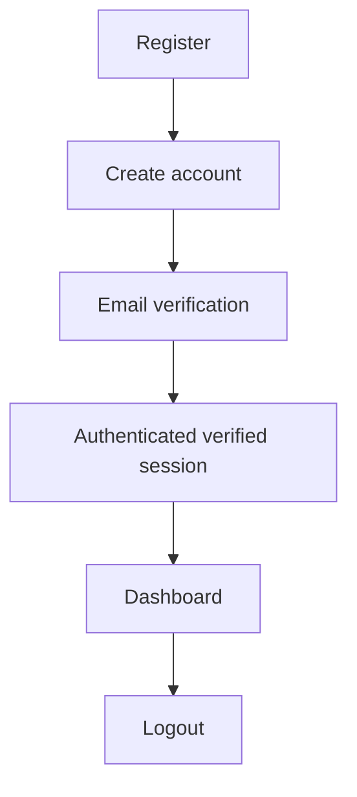
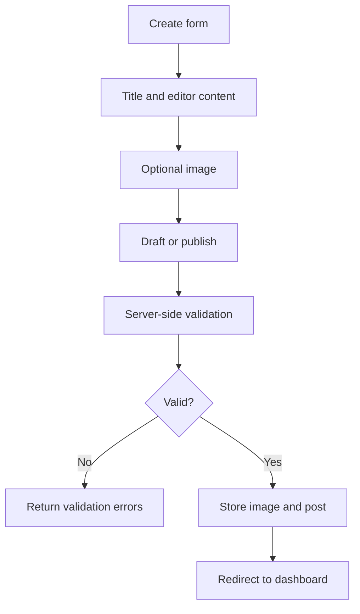

<div align="center">



# 📝 Blog Management System

**A Laravel + Inertia + Vue publishing application foundation, in active development.**

<p>
  
  
  
  
  
  
</p>

<p>
  <a href="https://github.com/Brajesh31/blog-management-system-laravel-vue-app/actions/workflows/quality.yml"></a>
  <a href="https://github.com/Brajesh31/blog-management-system-laravel-vue-app/actions/workflows/security.yml"></a>
  
  
  
  
  
</p>

**[📚 Documentation](docs/README.md)** · **[🧭 Roadmap](ROADMAP.md)** · **[🐛 Issues](https://github.com/Brajesh31/blog-management-system-laravel-vue-app/issues)** · **[🔐 Security](SECURITY.md)**

</div>

> ⚠️ **Project status: work in progress.** The repository contains working account/profile foundations and a post creation flow, but the feed page is missing, post detail/edit/update/delete actions are unfinished, and social-feature workflows are not fully connected. This README describes the current source, not a promise that every planned feature is available.

---

## 📑 Contents

- [🌟 Overview](#-overview)
- [🎯 Problem and solution](#-problem-and-solution)
- [✨ Features and implementation status](#-features-and-implementation-status)
- [🧰 Technology stack](#-technology-stack)
- [🖼️ Screenshots and demo](assets/screenshots/README.md)
- [⚙️ Requirements](#️-requirements)
- [🚀 Installation](#-installation)
- [▶️ Run locally](#️-run-locally)
- [📘 Usage](#-usage)
- [🏗️ Architecture](#️-architecture)
- [🔄 Main workflows](#-main-workflows)
- [🗃️ Database overview](#️-database-overview)
- [🌐 HTTP routes and API status](#-http-routes-and-api-status)
- [📁 Project structure](#-project-structure)
- [🧪 Testing and quality](#-testing-and-quality)
- [⚡ Performance considerations](#-performance-considerations)
- [🔐 Security and privacy](#-security-and-privacy)
- [♿ Accessibility](#-accessibility)
- [⚠️ Limitations](#️-limitations)
- [🛣️ Roadmap and future scope](#️-roadmap-and-future-scope)
- [🤝 Contributing](#-contributing)
- [📚 Documentation index](#-documentation-index)
- [🙏 Acknowledgements](#-acknowledgements)
- [👨‍💻 Maintainer](#-maintainer)
- [📄 License](#-license)

## 🌟 Overview

Blog Management System is a full-stack web application built with **Laravel 12**, **Inertia.js 2**, **Vue 3** and **TypeScript**. Laravel handles web routes, authentication, validation and relational persistence. Inertia connects server responses to Vue pages without a separate frontend API server.

The current implementation focuses on:
- Account registration, authentication, email verification and password recovery.
- Authenticated profile editing and account deletion.
- A TipTap-based post authoring form.
- Optional post cover-image upload.
- Draft and published submission states.
- Relational models for future engagement features.

The project is not yet a complete public blogging platform. The implementation status below is the source of truth.

## 🎯 Problem and solution

### Problem
A publishing experience needs identity, author ownership, structured content, validation, media handling, publication states, persistence and accessible page interactions. A database table or editor alone is not enough to make a secure publishing workflow.

### Current solution foundation
This repository combines Laravel's web/session stack with Eloquent models, Form Requests, Inertia, Vue components and a rich-text editor. It establishes a foundation for account and post authoring workflows while keeping backend responsibilities in Laravel.

### Objectives
1. Provide a reliable account foundation.
2. Allow verified users to manage their own profile.
3. Validate post title, content, visibility and optional image server-side.
4. Keep frontend and backend page contracts connected through Inertia.
5. Maintain relational models for content and potential engagement features.
6. Improve maintainability through tests, docs, workflows and operational guidance.

## ✨ Features and implementation status

| Area | What exists | Status |
|---|---|---|
| 🔐 Authentication | Registration, login, logout, email verification, password reset and confirmation routes/controllers/pages | Implemented foundation; real mail transport must be configured |
| 👤 Own profile | Edit/update and account deletion flow | Implemented foundation |
| 🪪 Username profile | Profile controller and page | Route currently requires authentication |
| ✍️ Post authoring | Title, TipTap HTML, optional image, draft/publish actions | Create flow exists |
| 📰 Feed | Search/pagination query and visibility filtering | Controller exists; target Vue page is missing |
| 📖 Post detail | Route | Controller action unfinished |
| 🛠️ Post edit/update/delete | Routes | Controller actions unfinished; ownership policy must be implemented |
| 💬 Comments/replies | Model, migration and relationships | Data layer only |
| ❤️ Likes and 🔖 bookmarks | Models, migrations and relationships | Data layer only |
| 🏷️ Tags | Model, migration and pivot relation | Data layer only |
| 🔔 Notifications | Model and migration | Data layer only; current layout uses placeholder data |
| 🔎 Search UI | Search component exists | MainLayout handler is a placeholder; full user journey is not wired |
| 📱 Responsive UI | Layout, mobile sheet and shared UI component families | Components exist; accessibility testing remains required |

### ✨ Editor capabilities
The TipTap editor is configured with StarterKit, Placeholder, Link and Image extensions. The editor emits HTML to the form. **TipTap configuration does not sanitize that HTML.** A server-side sanitization strategy is required before rendering saved posts to other users.

## 🧰 Technology stack

### Runtime and backend

| Technology | Version from project constraints | Purpose |
|---|---:|---|
| PHP | `^8.2` | Backend runtime |
| Laravel | `^12.0` | Routing, middleware, validation, ORM and application services |
| Inertia Laravel | `^2.0` | Laravel-to-Vue page integration |
| Laravel Sanctum | `^4.0` dependency | Installed dependency; no standalone token API is documented |
| MySQL | Sample/default DB connection | Relational persistence |

### Frontend and tools

| Technology | Declared dependency | Purpose |
|---|---:|---|
| Vue | `^3.4.0` | UI framework |
| TypeScript | `^5.6.3` | Frontend typing |
| Vite | `^6.2.4` | Development server and asset build |
| Tailwind CSS | `^4.1.3` | Utility styling |
| Pinia | `^3.0.1` | Frontend state management |
| TipTap | `^2.11.7` extensions | Rich-text editing |
| Pest | `^3.8` | PHP application tests |
| Laravel Pint | `^1.13` | PHP formatting |

Other frontend dependencies include Inertia Vue, Reka UI, VueUse, VeeValidate, Zod, Lucide Vue, Heroicons and Vue Sonner. Exact dependency versions are resolved by the lockfiles.

## 🖼️ Screenshots and demo

The repository contains an existing project logo at `public/images/blogx-logo.png`, plus original documentation assets:



No genuine screenshots or screen recordings of a running application were available during this update. They have not been fabricated. See [Screenshot capture guidance](assets/screenshots/README.md) and [Demo capture guidance](assets/demos/README.md).

**Live deployment:** no verified live deployment URL is configured in this repository.
**Demo:** no verified public demo is currently linked.

## ⚙️ Requirements

- PHP 8.2+ with the Laravel-required extensions and PDO driver.
- Composer 2.
- Node.js and npm compatible with the Vite 6 toolchain.
- MySQL or another database supported by Laravel. MySQL is the sample configuration.
- Git.

Check installed tools:

```powershell
php --version
composer --version
node --version
npm --version
```

## 🚀 Installation

Clone the repository:

```powershell
git clone https://github.com/Brajesh31/blog-management-system-laravel-vue-app.git
Set-Location blog-management-system-laravel-vue-app
```

Install PHP and frontend dependencies:

```powershell
composer install
npm ci
```

Create the local environment file:

```powershell
Copy-Item .env.example .env
```

Configure your local database in `.env`. The example uses MySQL:

```text
DB_CONNECTION=mysql
DB_HOST=127.0.0.1
DB_PORT=3306
DB_DATABASE=blog_management_system_laravel_vue_app
DB_USERNAME=your_local_user
DB_PASSWORD=your_local_password
```

Generate the application key and migrate:

```powershell
php artisan key:generate
php artisan migrate
```

If you are testing the current public-disk image upload:

```powershell
php artisan storage:link
```

Build the frontend:

```powershell
npm run build
```

See [Detailed installation](docs/installation.md) and [Configuration](docs/configuration.md).

## ▶️ Run locally

Start Laravel:

```powershell
php artisan serve
```

In a second terminal, start Vite:

```powershell
npm run dev
```

Alternatively, Composer provides a combined development command that starts the Laravel server, queue listener, Pail log viewer and Vite:

```powershell
composer run dev
```

Open the local URL printed by Artisan, usually `http://127.0.0.1:8000`.

The example environment uses `MAIL_MAILER=log`. Verification and password-reset messages are written to application logs rather than delivered to an inbox. Configure a real mail provider when testing actual email delivery.

## 📘 Usage

### Create an account
1. Open the home page and choose Register.
2. Complete registration.
3. Verify the email account if the route requires it.
4. For local development, inspect the configured log output for generated verification email.

### Manage your profile
1. Sign in.
2. Open the profile edit page.
3. Update your name or email and save.
4. A changed email address has its verification timestamp cleared.
5. Account deletion requires the current password.

### Create a post
1. Sign in with a verified account.
2. Open the post creation page.
3. Enter a title and compose content in TipTap.
4. Optionally select a JPEG, PNG, JPG, GIF or WebP image up to 2 MB.
5. Choose Save Draft or Publish.
6. The server validates the form and redirects to the dashboard.

**Important:** the post feed page is currently missing and post detail/edit/delete actions are unfinished. This means the complete reader and post-maintenance journeys are not ready. See [Usage guide](docs/usage.md).

## 🏗️ Architecture



### Request lifecycle

1. Browser sends a web request.
2. Laravel matches a route and executes middleware.
3. Controller and Form Request validate and process input.
4. Eloquent reads/writes relational records.
5. Controller returns an Inertia page or redirect.
6. Vue resolves the page and renders the response.

### Frontend architecture
- `resources/js/app.ts`: Inertia/Vue bootstrap.
- `resources/js/Pages/`: route-level page components.
- `resources/js/Components/`: reusable UI, navigation, auth and editor.
- `resources/js/Layouts/`: shared layout shell.
- `resources/js/hooks/`: composables.
- `resources/js/stores/`: Pinia stores.
- `resources/js/types/`: TypeScript definitions.

### Backend architecture
- `routes/`: web, auth and console routes.
- `app/Http/Controllers/`: route request handling.
- `app/Http/Requests/`: validation.
- `app/Models/`: Eloquent models and relationships.
- `database/migrations/`: schema.
- `tests/`: Pest/PHPUnit tests.

More detailed diagrams: [System Design](docs/system-design.md), [Workflow](docs/workflow.md), [Data Flow](docs/data-flow.md), [editable diagrams](docs/diagrams/README.md).

## 🔄 Main workflows

### Account flow



### Post creation flow



These diagrams show the current create/auth foundations. The post feed and detail flows are incomplete.

## 🗃️ Database overview

Main application entities include:

| Table | Purpose |
|---|---|
| `users` | Account identity, credentials and profile fields |
| `posts` | Author, title, HTML content, slug, image path and visibility |
| `tags` | Tag names, slugs and descriptions |
| `post_tag` | Post/tag many-to-many relation |
| `comments` | Post comments and parent/reply relationships |
| `likes` | User/post reaction records |
| `bookmarks` | User/post saved records |
| `notifications` | Recipient, sender, type, message and related records |

Laravel framework tables include sessions, cache and queue-related records where configured. See [Database schema](docs/database.md) for fields, relationships, constraints and migration operations.

## 🌐 HTTP routes and API status

This repository currently provides **Laravel web routes with session authentication and Inertia responses**. There is no separate `routes/api.php`, OpenAPI contract or published REST API.

Key route areas:
- Home and dashboard.
- Registration, login, logout, verification and password flows.
- Own profile update and deletion.
- Post feed/create and placeholder lifecycle routes.

The post feed controller currently targets a missing Vue page. Post detail/edit/update/delete controller methods are unfinished. See [HTTP Route Catalogue](docs/api.md) and [API Reference](docs/api-reference.md).

## 📁 Project structure

```text
.
├── .github/
│   ├── ISSUE_TEMPLATE/       # Bug, feature and documentation forms
│   └── workflows/            # Quality, security and README automation
├── app/
│   ├── Http/Controllers/      # Auth, profile, user profile and post controllers
│   ├── Http/Requests/         # Validation requests
│   └── Models/                # User, Post, Comment, Like, Bookmark, Tag, Notification
├── assets/
│   ├── banners/               # README project banner
│   ├── logos/                 # Original SVG mark
│   ├── illustrations/         # Editorial workflow illustration
│   ├── diagrams/              # Rendered diagram references
│   ├── screenshots/           # Genuine captures when available
│   ├── demos/                 # Authentic recordings when available
│   └── charts/                # Evidence-backed charts only
├── bootstrap/                 # Laravel bootstrap
├── config/                    # Framework configuration
├── database/
│   ├── factories/
│   ├── migrations/
│   └── seeders/
├── docs/                      # Project, architecture, security and operations docs
├── public/                    # Web root and static files
├── resources/
│   ├── css/
│   ├── js/                    # Vue pages, components, stores, hooks and types
│   └── views/
├── routes/                    # web.php, auth.php, console.php
├── storage/                   # Runtime storage placeholders
├── tests/                     # Pest feature and unit tests
├── artisan
├── composer.json / lock
├── package.json / lock
├── phpunit.xml
└── vite.config.js
```

For file-level detail, see [Project Structure](docs/project-structure.md), [Modules](docs/modules.md) and [Components](docs/components.md).

## 🧪 Testing and quality

Run backend tests:

```powershell
php artisan test
```

Check PHP formatting:

```powershell
vendor/bin/pint --test
```

Build and type-check frontend assets:

```powershell
npm run build
```

**Test database warning:** the SQLite overrides in `phpunit.xml` are commented out. Configure a dedicated disposable test database before running feature tests because database-refresh behavior may clear tables. Never point tests at production or valuable local data.

### GitHub Actions
- **Laravel and Vue Quality:** PHP syntax, Pint, frontend build and documentation inventory checks.
- **Dependency and secret hygiene:** Composer audit, npm audit and Gitleaks.
- **README automation:** updates the README timestamp.

The dependency audit currently reports vulnerabilities in locked Composer/npm dependency trees. The workflow is expected to fail until those advisories are reviewed and resolved. See [Dependency Audit Findings](docs/dependency-audit.md). A failing security badge is not something to hide.

## ⚡ Performance considerations

- The post query eager-loads user and tags, orders newest first and paginates 10 records.
- Search currently uses SQL LIKE across title, content and author name.
- Leading wildcard search may not benefit from ordinary indexes at larger scale.
- Images need deliberate resizing, cache and retention policy.
- No load-test baseline or measured performance score is published.

Measure before optimizing. See [Performance Guide](docs/performance.md).

## 🔐 Security and privacy

Before production, address:
- Post ownership authorization for every mutation and private-content read.
- Sanitization of TipTap HTML before public rendering.
- Image content validation, storage visibility and cleanup.
- Factory-generated shared development password; never seed production.
- Retention/deletion policy for user records, uploaded media, logs and backups.
- Production secrets, HTTPS, disabled debug output and least-privilege DB access.

Read [Security Review](docs/security.md), [Privacy](docs/privacy.md), [Data Governance](docs/data-governance.md) and root [SECURITY.md](SECURITY.md).

## ♿ Accessibility

Accessibility work should cover keyboard navigation, focus management, semantic page structure, accessible labels/errors, TipTap toolbar usability, contrast, zoom/reflow and reduced motion. No completed WCAG audit is claimed. See [Accessibility Guide](docs/accessibility.md).

## ⚠️ Limitations

- Missing `Posts/Index.vue` feed page.
- Unfinished post show/edit/update/destroy controller actions.
- No explicit post ownership policy identified.
- Stored TipTap HTML has no evidenced sanitizer.
- Social workflows remain data-layer foundations.
- MainLayout has placeholder notification state and no-op handlers.
- Username profile route currently requires authentication.
- Slug is generated, but route binding still uses the default key.
- No separate REST API/OpenAPI contract.

See the full [Limitations](docs/limitations.md) and [Technical Debt Register](docs/technical-debt.md).

## 🛣️ Roadmap and future scope

Priority order:
1. Complete feed and post lifecycle with server-side ownership policies.
2. Implement safe rich HTML sanitization and media lifecycle.
3. Complete comment, like, bookmark, tag and notification workflows.
4. Finish public profile, search and accessible reader experiences.
5. Expand integration tests, observability, backup restoration and dependency maintenance.

See [ROADMAP.md](ROADMAP.md) and [Future Scope](docs/future-scope.md).

## 🤝 Contributing

Contributions are welcome when they are focused, tested and aligned with the project status.
1. Read [CONTRIBUTING.md](CONTRIBUTING.md).
2. Search existing issues or open a focused proposal.
3. Use a descriptive branch and commit message.
4. Add tests and update related documentation/diagrams.
5. Complete the security, privacy and accessibility review in the pull request template.

Do not post vulnerabilities publicly; use [SECURITY.md](SECURITY.md).

## 📚 Documentation index

The complete documentation catalogue is available in **[docs/README.md](docs/README.md)**. Key entry points:

- [Project Overview](docs/project-overview.md)
- [Architecture and System Design](docs/architecture.md) · [System Design](docs/system-design.md)
- [Installation and Configuration](docs/installation.md) · [Configuration](docs/configuration.md)
- [Workflow and Data Flow](docs/workflow.md) · [Data Flow](docs/data-flow.md)
- [Routes and Database](docs/api.md) · [Database](docs/database.md)
- [Security, Privacy and Accessibility](docs/security.md) · [Privacy](docs/privacy.md) · [Accessibility](docs/accessibility.md)
- [Testing and Operations](docs/testing.md) · [Operations](docs/operations.md)
- [Troubleshooting and FAQ](docs/troubleshooting.md) · [FAQ](docs/faq.md)

## 🙏 Acknowledgements

This project builds on the work and documentation of the Laravel, Inertia.js, Vue, TypeScript, Tailwind CSS, TipTap, Pest and open-source component ecosystems. See [References](docs/references.md) for official documentation.

## 👨‍💻 Maintainer

**Brajesh Kumar** · [GitHub @Brajesh31](https://github.com/Brajesh31)

For project support, use [SUPPORT.md](SUPPORT.md). No private contact details are published in this README.

## 📄 License

This repository is distributed under the **MIT License**. See [LICENSE](LICENSE).

---

<div align="center">

**Built with Laravel, Vue and a focus on maintainable engineering.**

[⬆ Back to top](#-blog-management-system)

</div>

Last updated: 2026-11-19 00:55 UTC
