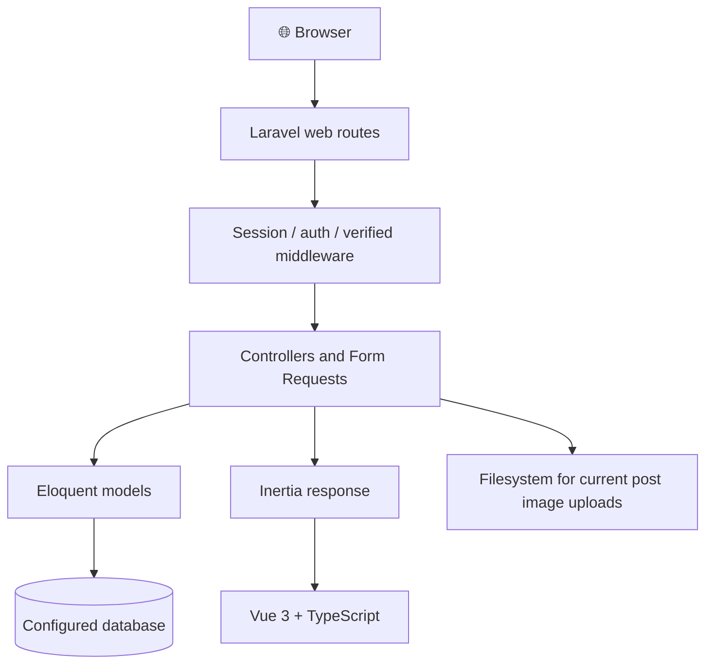

# 📚 Documentation Hub

Welcome to the complete documentation centre for **Blog Management System**, a Laravel 12 + Inertia.js + Vue 3 + TypeScript application. These guides describe the checked-in implementation and clearly separate existing behavior from proposed work.

> ⚠️ **Current status:** the app is in active development. The feed controller references a missing Vue page; post detail/edit/update/delete actions are unfinished; social models are not connected to complete workflows. Read [Limitations](limitations.md) before treating a workflow as available.

## 🧭 Product and architecture

| Guide | Purpose |
|---|---|
| [Project overview](project-overview.md) | Background, goals, intended users and implementation status |
| [Architecture](architecture.md) | Laravel/Inertia/Vue request architecture |
| [System design](system-design.md) | Context, containers, modules, trust boundaries and trade-offs |
| [Project structure](project-structure.md) | Directory map and file responsibilities |
| [Modules](modules.md) | Backend and frontend module inventory |
| [Components](components.md) | Layout, navigation, editor and shared UI components |
| [Features](features.md) | Feature-by-feature implementation status |
| [Workflow](workflow.md) | Account, profile, post and incomplete workflows |
| [Data flow](data-flow.md) | DFD Level 0, Level 1, Level 2 and data dictionary |

## ⚙️ Build, run and maintain

| Guide | Purpose |
|---|---|
| [Requirements](requirements.md) | User stories and acceptance criteria |
| [Installation](installation.md) | Local prerequisites, Composer/npm, DB and start |
| [Configuration](configuration.md) | Environment and runtime configuration |
| [Usage](usage.md) | Local user journeys supported by the current code |
| [HTTP routes](api.md) | Actual web/auth route catalogue |
| [API reference](api-reference.md) | Inertia/web request model; confirms no separate REST API exists |
| [Database](database.md) | Tables, Eloquent relationships and migrations |
| [Testing](testing.md) | Pest, PHPUnit, Pint and frontend build |
| [Test cases](test-cases.md) | Suggested scenario-level acceptance test catalogue |
| [Development](development.md) | Day-to-day backend and frontend workflow |
| [Coding standards](coding-standards.md) | PHP, Laravel, Vue, TypeScript and review conventions |
| [Git workflow](git-workflow.md) | Branching, commit messages and PR process |

## 🔐 Security, privacy and quality

| Guide | Purpose |
|---|---|
| [Security review](security.md) | Threat model and observed risks |
| [Dependency audit](dependency-audit.md) | Current CI audit findings and remediation approach |
| [Accessibility](accessibility.md) | Keyboard, screen reader, editor and responsive checks |
| [Privacy](privacy.md) | Data categories, lifecycle and retention decisions |
| [Data governance](data-governance.md) | Classification, stewardship, access reviews and disposal |
| [Internationalization](internationalization.md) | Current locale status and future localization approach |
| [Performance](performance.md) | Query observations and measurement plan |
| [Limitations](limitations.md) | Honest list of incomplete behavior |
| [Risk register](risk-register.md) | Prioritized product/security/technical risks |
| [Technical debt](technical-debt.md) | Code-level debt inventory |

## 🚀 Deploy and operate

| Guide | Purpose |
|---|---|
| [Deployment](deployment.md) | Production release setup |
| [Release process](release.md) | Pre-release, post-release and rollback checks |
| [Operations](operations.md) | Monitoring, release and incident operations |
| [Observability](observability.md) | Logs, health signals, metrics and alerts |
| [Backup and recovery](backup-and-recovery.md) | DB/media backup and isolated restore drill |
| [Troubleshooting](troubleshooting.md) | Common setup/runtime issues |
| [FAQ](faq.md) | Common questions |
| [Future scope](future-scope.md) | Proposed product phases |
| [Roadmap](../ROADMAP.md) | Prioritized work plan |

## 🧪 Examples and references

- [Development examples](examples/README.md)
- [Factory usage](examples/factory-usage.md)
- [Post creation contract](examples/post-creation.md)
- [Glossary](glossary.md)
- [References](references.md)
- [Architecture Decision Records](adr/README.md) and [ADR template](adr/template.md)
- [Editable Mermaid diagram index](diagrams/README.md)

## 🗺️ System overview

## ✅ Documentation maintenance

1. Update route/database/system docs with implementation changes.
2. Keep proposed controls clearly labeled.
3. Keep diagrams editable in `docs/diagrams/*.mmd`.
4. Never include secrets, personal data or production records in examples.
5. Add real screenshots only from a running app with synthetic data.
6. Update this index when documents are added or renamed.
