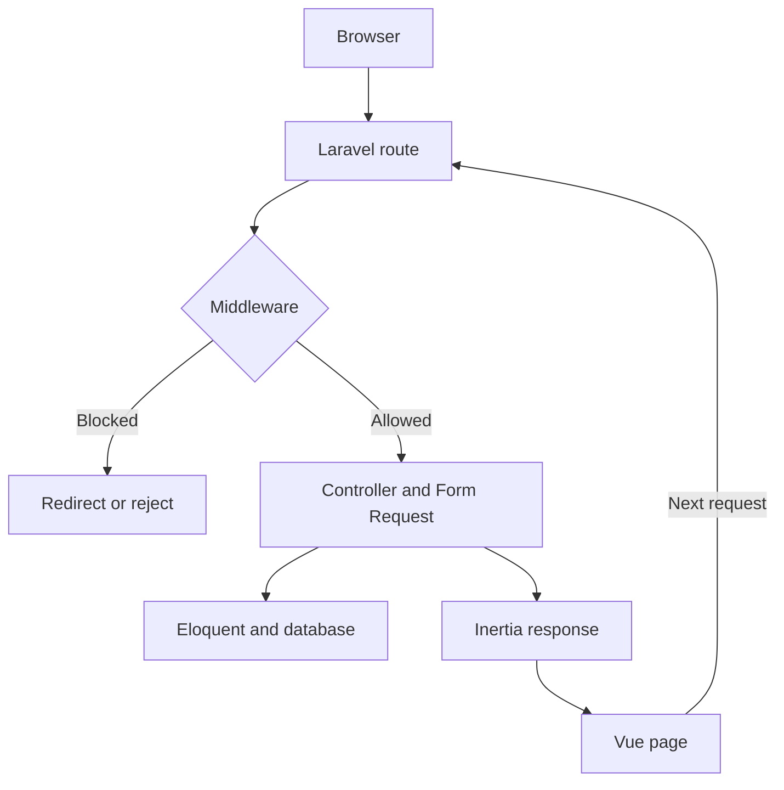

# 📚 Documentation Hub

This is the documentation centre for the Laravel 12 + Inertia.js + Vue 3 + TypeScript Blog Management System. It documents the implementation currently in the repository and labels incomplete workflows honestly.

> ⚠️ The feed controller references a missing `Posts/Index` page. Post detail/edit/update/delete actions are unfinished. Social tables and models exist without complete UI/controller workflows. Do not treat these as production-ready features.

## 🧭 Guides

| Guide | Scope |
|---|---|
| [Installation](installation.md) | PHP, Composer, Node/npm, MySQL, environment, migrations, storage and local run |
| [Architecture](architecture.md) | Laravel/Inertia/Vue structure, middleware, request and response boundaries |
| [Project structure](project-structure.md) | Directory map and file responsibilities |
| [Development](development.md) | Backend/frontend conventions and verification |
| [HTTP routes](api.md) | Actual web/auth routes, middleware and request fields |
| [Database](database.md) | Tables, Eloquent relationships, constraints and migration safety |
| [Configuration](configuration.md) | Environment variables, runtime drivers and safe settings |
| [Deployment](deployment.md) | Release checklist, secrets, web root, migrations and operations |
| [Security review](security.md) | Threat model and code-observed risk register |
| [Accessibility](accessibility.md) | Keyboard, screen readers, editor, forms and responsive behavior |
| [Privacy](privacy.md) | Data categories, lifecycle, retention and deletion considerations |
| [Testing](testing.md) | Pest, PHPUnit, Pint, TypeScript and safe test databases |
| [Operations](operations.md) | Monitoring, backup/restore, releases and incident response |
| [Troubleshooting](troubleshooting.md) | Startup, DB, Vite, routes, mail and uploads |
| [FAQ](faq.md) | Current behavior and common setup questions |
| [Diagrams](diagrams/README.md) | Editable Mermaid sources |
| [Risk register](risk-register.md) | Prioritized technical/product risks |
| [Glossary](glossary.md) | Repository terminology |
| [ADRs](adr/README.md) | Architecture decision records and template |

## 🗺️ Request flow

## ✅ Documentation rules

1. Update route, database and architecture docs when behavior changes.
2. Keep examples free of secrets, personal data and production records.
3. Label proposed controls and incomplete features explicitly.
4. Keep Mermaid source editable in `docs/diagrams/*.mmd`.
5. Report checks truthfully. A passing frontend build does not prove authorization or production readiness.

## 🔐 Help

Use [SECURITY.md](../SECURITY.md) for private vulnerability reporting, [SUPPORT.md](../SUPPORT.md) for normal help, and [CONTRIBUTING.md](../CONTRIBUTING.md) for code changes.
