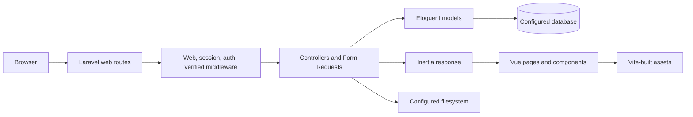

# Architecture

## Application shape

This is a Laravel monolith with an Inertia.js and Vue 3 client. Laravel owns the web routes, authentication, validation, database access, and page responses. Inertia passes controller data to Vue page components without a separate frontend server or REST API.

The application is bootstrapped in `bootstrap/app.php`. It registers `routes/web.php`, `routes/console.php`, and Laravel's `/up` health endpoint. The `web` middleware stack is extended with `HandleInertiaRequests`, which shares the authenticated user with Inertia responses. Authentication endpoints are registered from `routes/auth.php`.

## Request and rendering flow

1. A browser request enters a route in `routes/web.php` or `routes/auth.php`.
2. Laravel applies web/session middleware and, where required, `auth` and `verified` middleware.
3. A controller or route closure validates input, reads or writes Eloquent models, and returns a redirect or Inertia response.
4. Inertia resolves the page name to a Vue component under `resources/js/Pages/` and passes the response props to it.
5. `resources/js/app.ts` starts the client, and Vite compiles the Vue application, CSS, and dependencies.

`resources/views/app.blade.php` is the Inertia root document. `vite.config.js` configures the Laravel and Vue Vite plugins.

## Main code areas

- `app/Http/Controllers/`: authentication, profile, and post request handling.
- `app/Http/Requests/`: server-side request validation for profile updates and post creation.
- `app/Http/Middleware/`: shared Inertia props.
- `app/Models/`: Eloquent models and relationships for users, posts, tags, comments, likes, bookmarks, and notifications.
- `database/migrations/`: relational schema; factories and seeders provide development/test records.
- `resources/js/Pages/`: Inertia page components; `Components/` contains reusable UI and editor pieces.
- `routes/`: web routes, authentication routes, and console routes.
- `tests/`: Pest feature and unit tests.

## Authentication and access

Authentication uses Laravel's session-based web guard and the Laravel Breeze controller pattern. Registration, login, email verification, password reset, password confirmation, password changes, and logout are routed through `routes/auth.php`. The dashboard requires authentication and verified email. Post creation routes also require both `auth` and `verified`; profile management requires authentication.

The username profile route is currently inside an authenticated group. Post edit/update/delete routes and controller methods exist, but the controller actions are unfinished and no explicit post ownership policy is present. Access rules must be implemented and tested on the server before those operations are used.

## Data and files

Eloquent reads and writes use the configured Laravel database connection. MySQL is the example default. Database-backed sessions, cache, and queues are enabled in `.env.example`; their supporting tables are created by migrations. The post creation controller writes validated image uploads to the `public` filesystem disk under `uploads/posts`; expose that disk only through the configured Laravel storage link and hosting rules.

## Current boundaries and gaps

- There is no `routes/api.php` or separate JSON API contract; `docs/api.md` describes the current HTTP/web routes.
- The post listing controller returns an Inertia component named `Posts/Index`, but that Vue page is absent from the repository.
- The post detail, edit, update, and delete controller actions are placeholders.
- Social tables and relationships exist, but complete comment, like, bookmark, tag, and notification request flows are not implemented.
- TipTap content is stored as HTML. It must be sanitized or rendered safely before output; browser-side editor configuration is not a sanitization boundary.

These are implementation notes, not intended behavior guarantees. See the [README](../README.md) and [Roadmap](../ROADMAP.md) for the current feature state.
