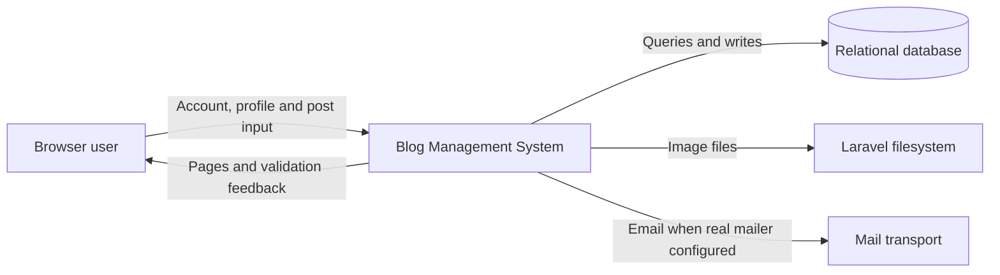
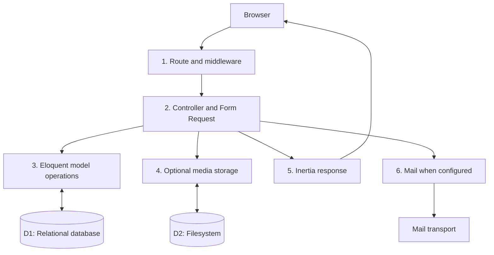
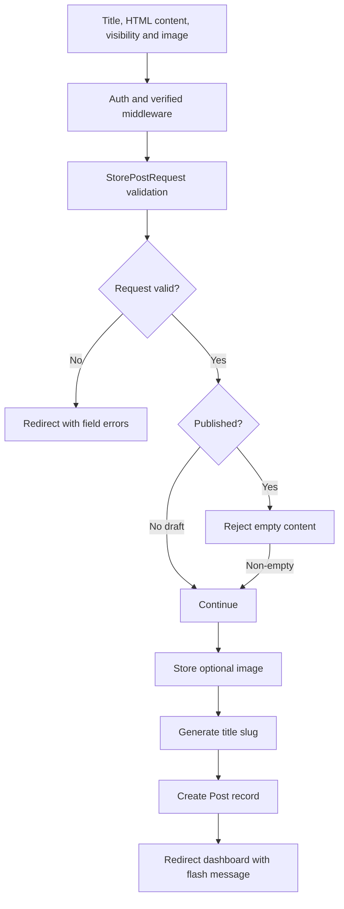

# 🔀 Data Flow and Processing

This guide maps request data entry, validation, persistence and Inertia responses.

## DFD Level 0: system context

## DFD Level 1: application processes

## DFD Level 2: post creation

The current flow does not show HTML sanitization or an explicit ownership policy because those controls are not established in the source. Add both before production use, along with cleanup if a file is stored but DB persistence fails.

## Data dictionary overview

| Data | Input/source | Handling | Destination |
|---|---|---|---|
| Account name/email/password | Registration form | Laravel validation and password hashing | users |
| Profile fields | Profile edit form | ProfileUpdateRequest | users |
| Post title | Create form | Required string, max 255 | posts.title |
| Post content | TipTap editor | Nullable string; empty publish rejected | posts.content as HTML |
| Visibility | Draft/publish action | Only draft/published accepted in StorePostRequest | posts.visibility |
| Cover image | Browser file input | JPEG/PNG/JPG/GIF/WebP, max 2 MB | Public disk path in posts.image |
| Slug | Derived from title | Collision suffix generation | posts.slug |
| Profile picture path | User record/profile controller | URL assembled using storage path convention | User media path; upload lifecycle needs review |

## Security requirements
- Validate on the server, not only in the browser.
- Enforce ownership and visibility before every server-side read or mutation.
- Treat saved editor HTML as untrusted.
- Do not trust file extensions or browser MIME values as the only upload control.
- Keep private records out of Inertia props returned to unauthorized sessions.
- Avoid logging content, passwords, reset tokens or session values.
- Define retention, deletion and backup procedures for DB and media.
