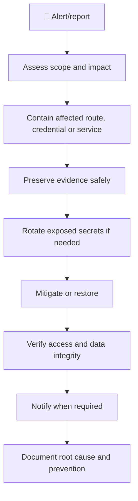

# 🧰 Operations and Maintenance

Adapt service names and commands to the actual host. This repository does not define an SLA or provider-specific deployment contract.

## Service map

- Web server/PHP runtime serves Laravel from `public/`.
- Database stores users, posts and framework records.
- Vite-built assets are served from `public/build/`.
- Current post creation stores images on Laravel's public filesystem disk.
- A supervised queue worker is needed when database-backed jobs are dispatched.

## Release checklist

- [ ] Review code, lockfile and migration changes.
- [ ] Back up database and required files; verify restore access.
- [ ] Build frontend and install production PHP dependencies.
- [ ] Configure protected environment values and disable debug.
- [ ] Confirm document root is `public/`, HTTPS and secure cookies work.
- [ ] Apply reviewed migrations with `php artisan migrate --force`.
- [ ] Check storage/cache permissions.
- [ ] Restart PHP and queue workers.
- [ ] Verify health, authentication, mail, DB, media and enabled workflows.
- [ ] Record release ID, migration result and rollback decision.

## Monitoring

Laravel's configured `/up` endpoint is a basic health signal. It does not prove database, mail, queue, backups or user journeys are healthy.

Monitor HTTP availability/latency, PHP saturation, exceptions, failed jobs, database capacity/slow queries, filesystem space, queue backlog and backup status. Avoid recording passwords, reset links, cookies, private post bodies or unnecessary personal identifiers.

## Backup and restore

Back up database and required uploaded files consistently. Restrict access, encrypt where appropriate, define expiry and keep copies separate from the production host. A database-only backup may omit user media.

Restore drill:
1. Verify backup integrity and decryption access.
2. Restore DB into an isolated environment.
3. Restore media and check paths/permissions.
4. Confirm app key/environment compatibility.
5. Test login and representative reads.

Never validate restore by overwriting production.

## Incident response

Preserve relevant evidence; limit access to the incident workspace. Do not distribute personal data. Follow [SECURITY.md](../SECURITY.md) for suspected vulnerabilities.

## Recovery priorities

Restore database consistency, authentication and required user media. Reconcile files uploaded around an incident, verify queue processing and review permissions before reopening affected workflows. Define recovery time and data loss objectives for the actual service; this repository has no stated targets.
