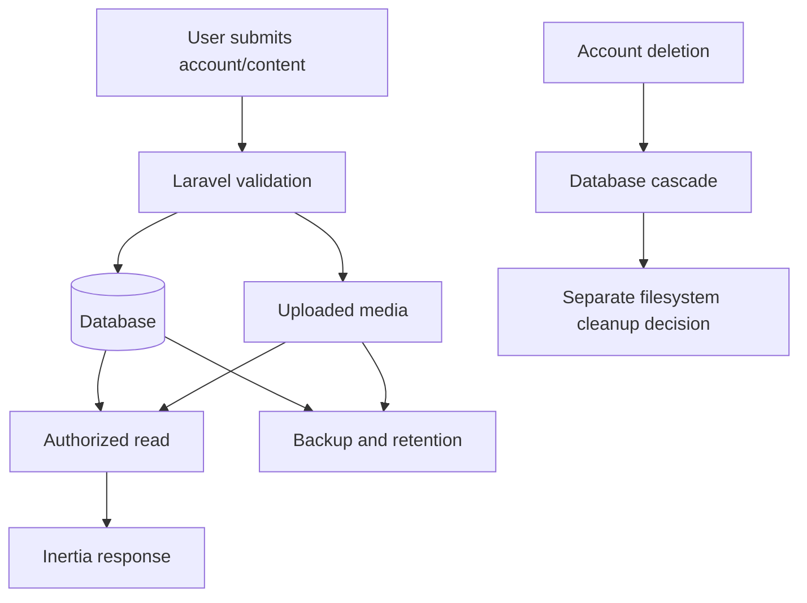

# 🛡️ Privacy and Data Lifecycle

This guide documents technical data handling visible in the application. It is not a legal privacy notice or compliance certification.

## Data categories

| Category | Examples | Current location |
|---|---|---|
| Account | Name, username, email, password hash, verification time | `users` table |
| Session/security | Session ID, user ID, IP, user agent, activity | `sessions` table when DB sessions are enabled |
| Content | Post title, TipTap HTML, visibility, slug | `posts` table |
| Media | Post image path and image file | Public filesystem disk in current create flow |
| Engagement | Comments, likes, bookmarks, tags | Relational tables |
| Notifications | Recipient, sender, type, message, related records, read time | `notifications` table |
| Operations | Application errors, queue failures and server logs | Configured runtime/log storage |

## Lifecycle model

The repository does not currently implement a complete retention schedule, user export flow, media cleanup routine or formal privacy request process.

## Decisions before launch

1. **Purpose and visibility:** define whether profiles, published posts, drafts, comments and media are public or restricted.
2. **Minimization:** collect only the account and operational data necessary for the service.
3. **Content:** disclose when posts become public and sanitize user-authored HTML.
4. **Uploads:** decide whether images are public by design and how long they persist after deletion.
5. **Retention:** define periods for sessions, logs, failed jobs, deleted accounts, backups and media.
6. **Deletion:** document DB cascade behavior and separately handle filesystem objects.
7. **Backups:** restrict, encrypt where appropriate, expire and restore-test backups.
8. **External processors:** do not transmit user content or identifiers to outside services without an approved purpose and suitable notice.

## Account deletion and media

Database foreign keys cascade deletion from users through related records. Filesystem objects do not participate in database foreign keys. Therefore, deleting a database row does not prove that its uploaded image has been deleted. Implement and test a media cleanup lifecycle before claiming complete erasure.

## Safe diagnostics

Never share `.env`, credentials, reset tokens, cookies, database dumps, private post bodies, personal email lists or unredacted IPs in issues. Redact or synthesize examples. Restrict log access and avoid logging rich text bodies or file content.

## Privacy notice topics

A deployment's user-facing notice should receive legal review and describe the responsible operator, data categories and purposes, recipients/processors, transfers where applicable, retention, user rights and request channel, security practices, cookies/session behavior and change process. This technical document is not a substitute.
