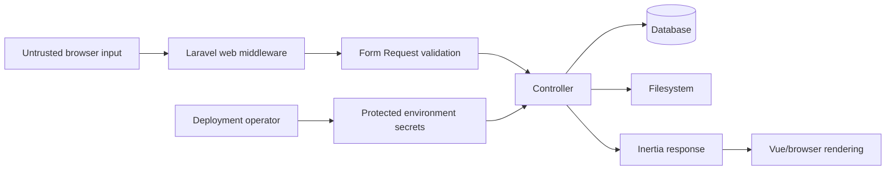
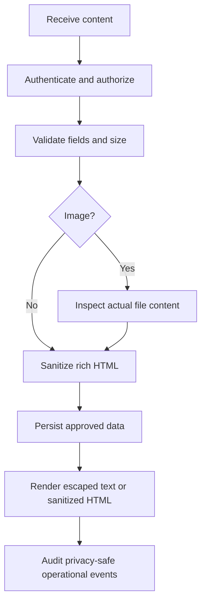

# 🔐 Security Review and Threat Model

This document records risks visible in the repository. It is not a penetration test, external audit or compliance certification.

## Trust boundaries

Treat browser fields, uploads, rich-text HTML, route parameters, search strings, cookies and user-authored database content as untrusted. Authentication identifies an account; authorization decides which resources that account may access.

## Findings and required controls

| Priority | Finding | Impact | Recommended action |
|---|---|---|---|
| Critical before mutation launch | Post edit/update/delete actions are unfinished and no post ownership policy is evident | Authenticated users must not be able to change another user's post | Implement Laravel policies; test owner, other user, guest and administrative cases |
| High | TipTap HTML is stored in `posts.content` | Unsafe rendering may create stored XSS | Sanitize with strict allowlist and adversarial tests before rendering |
| High | Images are saved on the public disk | Media may be publicly addressable and remain after post deletion | Decide visibility, validate content, generate names, process images, limit uploads and clean orphan files |
| High | Factory users share development password `password123` | Accidental production seeding creates predictable accounts | Restrict seeding to disposable environments and protect production |
| Medium | Username profile route is behind `auth` | Public-profile expectation is unclear | Decide access model and test route guards |
| Medium | Slug is generated but route binding uses default primary key | URLs may not behave as assumed | Configure slug binding or document numeric IDs |
| Medium | DB visibility enum is broader than create request | UI, model and schema may disagree | Define allowed states and legal transitions |
| Medium | Search uses substring LIKE across title/content/author | Large tables may scan many rows | Bound input, inspect query plans and add suitable indexing |
| Medium | Account deletion cascades DB records but cannot delete filesystem objects | User media may remain after account deletion | Add explicit media cleanup and retention tests |
| Medium | Social models/tables have no complete workflows | UI may imply functionality that does not exist | Implement one workflow at a time with policy and abuse tests |
| Medium | Retention and privacy processes are not defined | Data may be retained longer than intended | Define deletion, export, backup and log-retention policy |

## Recommended content flow

This is a target control flow, not a claim that every control currently exists.

## Authentication and sessions

- Keep Laravel CSRF protection for session-based web mutations.
- Use HTTPS and secure, HTTP-only, same-site cookies appropriate to the hosting environment.
- Regenerate session identifiers on login and invalidate them on logout.
- Keep Laravel's password hashing behavior and verify reset/verification mail transport.
- Add rate limits to high-risk content creation and account endpoints.
- Never expose debug stack traces in production.
- Enforce visibility and ownership on every server-side read and write.

## Upload controls

The create request currently accepts JPEG, PNG, JPG, GIF and WebP up to 2 MB. That is a useful validation layer, not full upload security. For production, inspect actual file content, generate server-side names, consider safe image re-encoding, reject unsupported content, prevent path traversal, define public/private access, and remove orphaned media.

## Release security checklist

- [ ] Secrets are injected through protected environment configuration.
- [ ] `APP_DEBUG=false` and web root is only `public/`.
- [ ] Dependencies and runtime are patched.
- [ ] Cross-account authorization tests exist.
- [ ] Rich HTML allowlist and regression tests exist.
- [ ] Upload storage and cleanup are deliberate.
- [ ] Backups are restricted and restoration is tested.
- [ ] Logs exclude secrets and unnecessary personal content.
- [ ] Vulnerabilities are reported privately using [SECURITY.md](../SECURITY.md).
