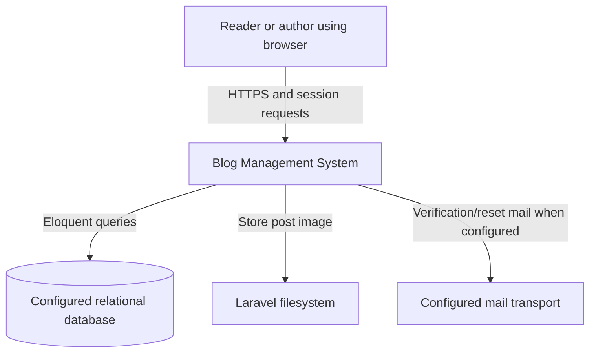
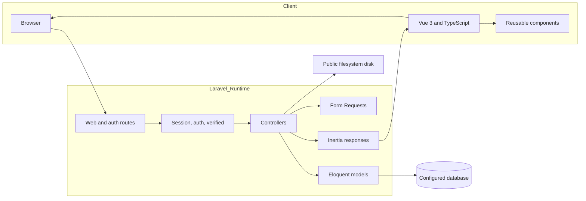

# 🏗️ System Design

This describes architecture visible in the repository. No separate API service, microservice architecture or external content-processing service is present.

## 1. Design style
The application is a **server-rendered Laravel monolith with Inertia-driven Vue pages**. The browser sends web requests. Laravel matches routes and applies middleware. Controllers and Form Requests handle request logic and validation. Eloquent models represent relational data. Controllers return redirects or Inertia responses. Vue renders pages and sends subsequent requests through Inertia.

## 2. Context view

The example mailer uses the log driver and does not deliver email to an inbox.

## 3. Container view

## 4. Backend responsibilities

| Module | Responsibility |
|---|---|
| Routing | Web and authentication URL surface |
| Authentication controllers | Registration, login, password and verification |
| Profile controllers | Own profile update and username profile rendering |
| Post controller | Feed query and post creation |
| Form Requests | Validate profile and post creation input |
| Eloquent models | Table attributes and relationships |
| Migrations | Application and framework tables |
| Middleware | Share authenticated user context with Inertia |

## 5. Frontend design
- The TypeScript app entry bootstraps Inertia and Vue.
- Pages under resources/js/Pages are route-level Vue components.
- resources/js/Components contains shared UI, navigation, authentication and editor components.
- MainLayout provides the primary navigation/layout shell.
- The TipTap folder contains the rich-text editor and toolbar.
- Pinia stores and Vue composables are separated into stores/hooks.

Some layout behaviors are placeholders, including the notification array and no-op event handlers in MainLayout. They are not a connected backend notification/search feature.

## 6. Data design
The schema is relational. Users own posts and comments. Posts associate with tags through a pivot and have comment, like and bookmark records. Notifications can reference users, posts and comments. See [Database](database.md).

## 7. Security boundaries
The browser is untrusted. Laravel must enforce authentication, resource authorization and validation. Rich HTML and media remain untrusted after client validation. Unfinished post mutation actions and the absence of an evidenced HTML sanitizer are release blockers for those workflows.

## 8. Reliability and performance
The sample environment uses database-backed queue/session/cache settings. These require migrations and appropriate workers/configuration. The feed query paginates 10 records and eager-loads user/tags, while substring search may need optimization at scale. No load-test results or production SLOs are included.

## 9. Design constraints
- Do not split into services without a measured operational reason.
- Keep Inertia props minimal and typed.
- Use Form Requests and policies for server-side boundaries.
- Add schema changes as forward migrations.
- Keep media lifecycle separate from DB cascade assumptions.
- Record significant changes in [ADRs](adr/README.md).
