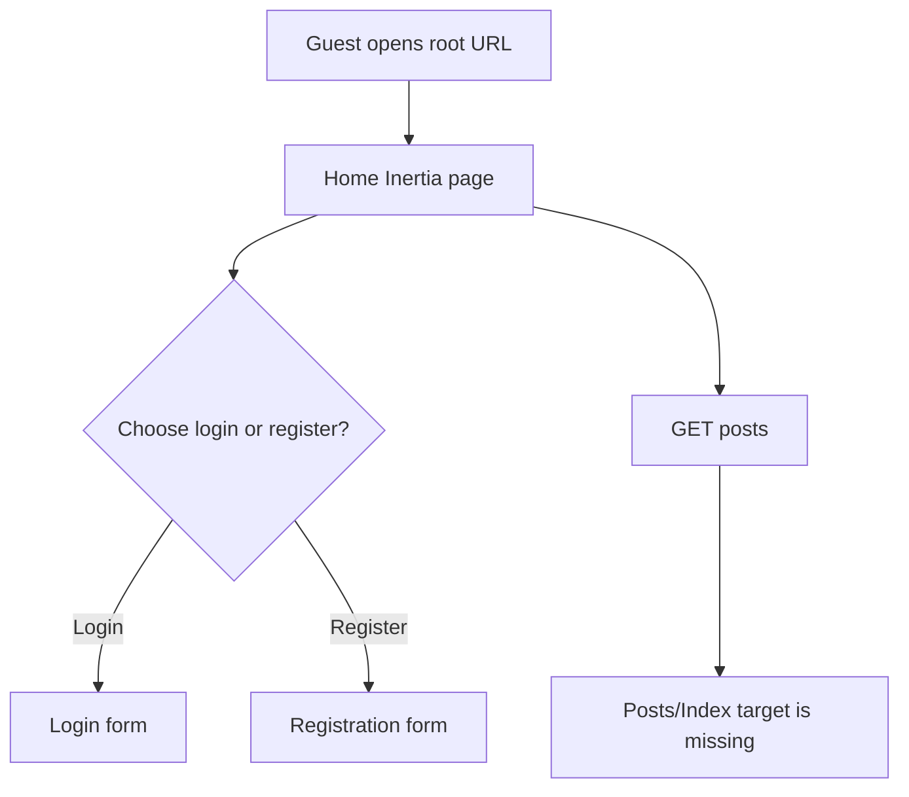
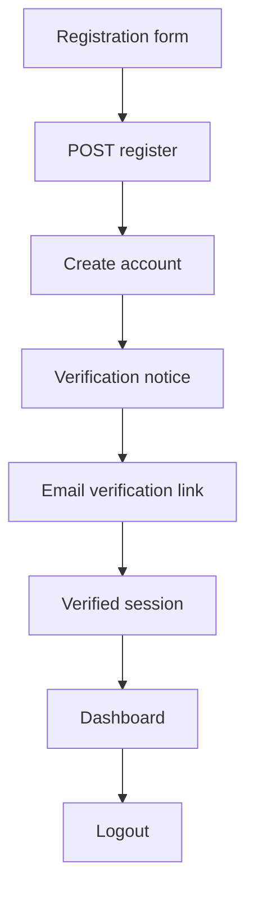
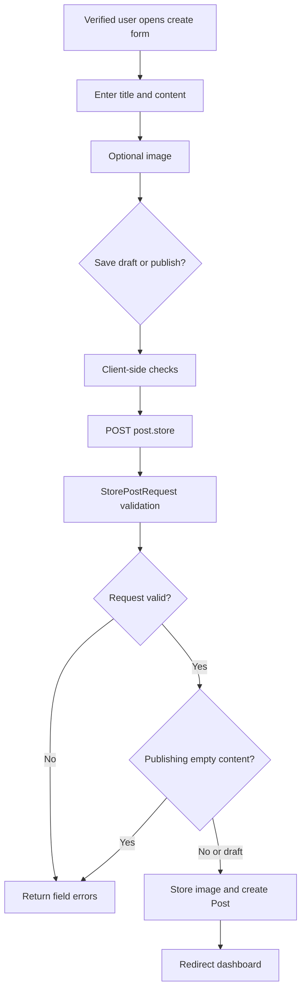

# 🔄 Application Workflows

These flows distinguish paths observed in source from incomplete work.

## 1. Guest entry

The Home page includes community-join/challenges components. The posts controller performs a query but refers to an Inertia page absent from the checked-in page tree.

## 2. Account lifecycle

Configure a real mailer for inbox delivery. The local example writes generated mail to logs.

## 3. Post creation

Client-side checks cannot replace server validation. HTML sanitization is a separate requirement and is not evidenced in this path.

## 4. Profile management
- GET profile renders the authenticated user's edit form.
- PATCH profile validates and updates the current user's name/email.
- If email changes, the verification timestamp is cleared.
- DELETE profile requires the current password, logs out and deletes the account.
- GET username route renders a profile, but it is currently inside an authenticated group.

Database cascades do not automatically delete filesystem assets.

## 5. Incomplete workflows

| Workflow | Current status |
|---|---|
| Post feed rendering | Query exists; target Vue page missing |
| Post detail | Route exists; controller action unfinished |
| Edit/update/delete post | Routes exist; actions unfinished |
| Comments/likes/bookmarks | Models and migrations exist; endpoints/pages not wired |
| Tags | Model/relationship/schema exist; assignment workflow not wired |
| Notifications | Data model exists; layout contains placeholder state and no-op handlers |

Do not expose incomplete workflows as supported user journeys. See [Features](features.md) and [Limitations](limitations.md).
